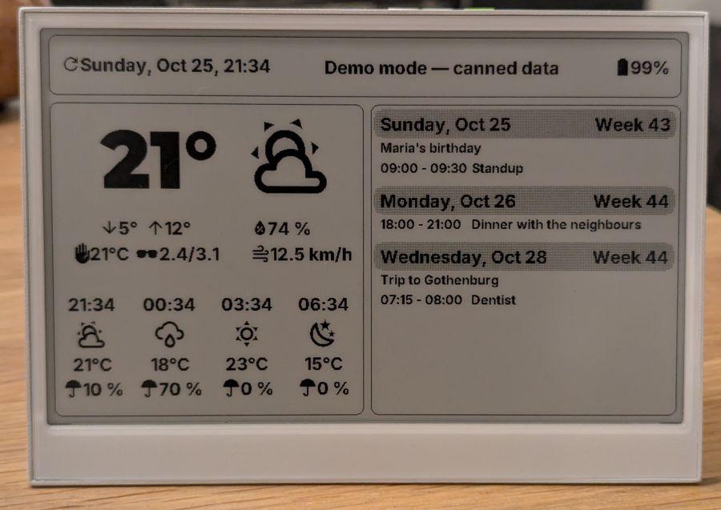

# reTerminal E1001 E-Ink Weather & Calendar Dashboard

An ESPHome firmware for the [Seeed reTerminal E1001](https://wiki.seeedstudio.com/reterminal_e1001/) that turns its 7.5" e-paper display into a wall dashboard for the entrance hall. All data comes from Home Assistant over the native API: weather from a `weather.*` entity, events from two calendars, and a status text from an input helper.

 — 7.5" e-ink, 1-bit, grayscale simulated via dithering.



Running in demo mode — the exact panel a new user sees straight after flashing, before any Home Assistant wiring.

## Quickstart

```sh
git clone <this repo> && cd reTerminalE1001_Dashboard
cp secrets.yaml.sample secrets.yaml     # then edit in your wifi + keys
# point the substitutions at the top of reterminal-e1001-entrance.yaml
# at your weather entity / calendars, then:
esphome run reterminal-e1001-entrance.yaml
```

No Home Assistant wiring yet? Set `demo_mode: 'true'` and the dashboard fills from canned data — including a canned header status (`demo_status`) and, via `demo_missing`, selective gaps to exercise the dynamic layout (hidden rows / placeholders) with no HA at all. The full test matrix is in [docs/testing.md](docs/testing.md).

## Display layout

```
┌──────────────────────────────────────────────────────────────┐
│ ⟳ Tue, Oct 12, 14:32     all systems nominal        🔋 76%   │  header
├──────────────────────────────┬───────────────────────────────┤
│                              │                               │
│        21°     (condition)   │  Monday, Oct 24      Week 43  │
│   ↓5°  ↑12°        ⛅ 110px    │  09:00 - 10:30   Standup      │
│   ✋ 18°C  🕶 3.2/5.8       │  ─────────────   Birthday x  │
│                              │  Tuesday, Oct 25     Week 43  │
│   💧 74 %                    │  ...                          │
│   💨 12.5 km/h               │                               │
│                              │                               │
│  15:00 ⛅ 16°C ☂ 10 %  ... 4 hourly forecast slots            │
└──────────────────────────────┴───────────────────────────────┘
```

- **Header** — status text (from `input_text.dashboard_status`, centered), last refresh time (left), battery level (right, hidden at 100 %).
- **Left panel, current weather** — big temperature (Montserrat Black 100 px) with the day's low/high, **feels like** (hand icon) and **UV index** (sunglasses icon) in one row underneath, then humidity and wind speed under the large condition icon (MDI, 110 px).
- **Left panel, hourly forecast** — four 3-hour slots at +0/+3/+6/+9 hours: time, condition icon, temperature, precipitation probability. Rows whose field the weather provider does not serve are hidden automatically (toggle via the `hide_missing` substitution). Without calendar content the strip doubles to eight 2-hour slots (+0…+14 h, roughly a 16 h awake window).
- **Right panel, calendar** — next 14 days from up to four calendars (substitutions at the top of the YAML; defaults use two), merged and deduplicated, grouped under day headers with ISO week numbers, all-day events supported. Without any calendar content — every calendar disabled, a quiet week, or a fetch cycle that returned no events — the weather panel widens to the full content width (aligned with the header box), the current-weather group centered within, and the hourly strip showing its full eight 2-hour slots.
- **Battery warning screen** — below 20 % the whole dashboard is replaced by a large "Battery low — please charge the device" screen.

## Files

| File | Purpose |
|---|---|
| `reterminal-e1001-entrance.yaml` | The firmware: hardware pins, fonts, sensors, the `refresh_dashboard` script, display lambda |
| `display_helpers.h` | Generic drawing: text measurement, rounded/dithered rectangles, icon+text pairs, `fit_text` |
| `weather_helpers.h` | Weather data structs, feels-like calculation, condition→icon mapping, current weather & hourly forecast drawing |
| `calendar_helpers.h` | Event parsing, sorting/dedup, date helpers, fetch-window formatting, calendar drawing |
| `battery_helpers.h` | Battery level from voltage (calibration table), header & warning screen drawing, external-power detection from the SY6974B charger |
| `sleep_helpers.h` | Battery saver: EXT1 button wake, deep sleep entry, awake-window accounting, HA button replay |
| `fetch_helpers.h` | Refresh fetch bookkeeping: per-fetch tickets, redraw trigger, hang watchdog |
| `demo_helpers.h` | Canned data for `demo_mode` — the full layout without any HA wiring |
| `secrets.yaml.sample` | Throwaway but format-valid secrets to copy to `secrets.yaml` |
| `docs/` | [community-plan.md](docs/community-plan.md) (roadmap), [testing.md](docs/testing.md) (test matrix), [weather-data.md](docs/weather-data.md) (Met.no field availability reference) |
| `fonts/` | `Montserrat-Black.ttf`, `materialdesignicons-webfont.ttf` (Inter is pulled from Google Fonts at build time) |

The helper headers are wired in via `esphome: includes:` and hold all layout/rendering logic; the YAML stays mostly declarative. Measured text metrics drive the layout, so font sizes can be changed in the YAML without touching pixel math.

## Hardware notes (reTerminal E1001, ESP32-S3, esp-idf)

- **E-paper:** Waveshare 7.5" v2 alt (`7.50inv2alt`), SPI on GPIO7/9, CS GPIO10, DC GPIO11, reset GPIO12, busy GPIO13. `update_interval: never` — the display is only redrawn when a refresh cycle completes, to avoid e-ink flicker.
- **Buttons:** green (GPIO3) triggers a manual refresh; middle (GPIO4) and left (GPIO5) are free for Home Assistant. All three are internal GPIO binary sensors whose presses fire a type (`green`/`middle`/`left`) on the **"E1001 Buttons" event entity** — stateless momentary signals; HA automations use the *Event received* trigger with the type as the option. The entity's state is the last event's timestamp, so a press remains visible even after the device sleeps.
- **Buzzer:** GPIO45 via LEDC PWM, exposed as a `light` entity (brightness = volume) in Home Assistant.
- **Battery:** voltage on GPIO1 ADC through a divider (×2, enabled via GPIO21 bridge), 60 s polling; percentage from a Seeed calibration table, clamped 0–100 %. Impossible readings (< 2.5 V) are dropped.
- **USB/serial:** the USB-C goes through a CH340 USB-to-UART bridge on UART0 (GPIO43/44) — not the ESP32-S3's native `USB_SERIAL_JTAG`, whose pins (GPIO19/20) carry the sensor I2C bus. `hardware_uart: UART0` is set accordingly, but note: on current ESP-IDF builds the app's log output does not reach the bridge (ROM/bootloader output does) — the reliable log channel is the network (`esphome logs <ip>`), and the "E1001 Wake Info" text sensor exposes the boot-time wake cause to Home Assistant for post-hoc diagnosis.
- **Charger:** Silergy SY6974B on I2C1 (SDA GPIO39, SCL GPIO40, address 0x6B); its input-source bit (REG0A `BUS_GD`) drives the "External Power" binary sensor and the battery saver. Empirically, on at least one production batch the charger never ACKs on either I2C bus, even with USB attached (the board's schematic carries a design-change note, suggesting batches differ) — and on the ESP32-S3 a silent address may surface as a generic bus error rather than a clean NACK, so the firmware does not distinguish: silence on both buses leaves the pack voltage to decide (≥ 4.15 V reads as powered, below that as on battery). Undetermined (the brief window before the first read, ~5 s after boot) counts as *powered* — the fail-safe direction. (The board also exposes a PCF8563 RTC and an SHT4x sensor on I2C0, unused so far.)

## Battery saver

On by default (`battery_saver: 'false'` to turn it off; plus `battery_sleep_seconds` / `battery_awake_seconds` / `battery_button_awake_seconds`). On external power it is completely inert — the sleep logic only engages when the "External Power" sensor reads off, so a wall-powered dashboard never sleeps, never changes cadence, and has nothing to notice. While on battery, the device deep-sleeps between refreshes — waking every 15 min (default) for a refresh plus a 30 s window in which HA can reach it, and on any of the three buttons. The e-ink image persists through sleep; plugging back in disables sleeping from the next wake. Details, semantics and the on-device verification checklist are in [docs/battery-saver-plan.md](docs/battery-saver-plan.md). Key semantics:

- **Button presses during sleep are replayed to HA** — as event-entity types, a few seconds after HA's states arrive at the wake (delivered from the battery-saver tick, never inside the automation that detects the arrival — that runs in an api message handler before HA has subscribed to device entities). Events are one fire-and-forget message per press: no state, no pulse, no on/off ordering — immune to the api's deferred, state-deduplicated sends that collapsed the earlier binary-sensor pulse into a single "off".
- **Awake holds:** hold the green button ~5 s after a wake (session-local hatch, for OTA/logs), or set the `keep_awake_entity` helper (`input_boolean.e1001_keep_awake` by default) in HA — the helper latches the device awake until turned off; set while asleep, it takes effect at the next wake.
- While asleep the device is unreachable: buzzer silent, status/refresh land at the next wake, no OTA.
- **OTAs survive the first sleep:** an ESP32 OTA app must confirm itself before any reset, or the bootloader rolls the update back — and a fresh app whose first awake window expires inside the safe-mode verify period (60 s) would roll back at the wake, silently restoring the *previous* firmware. The sleep entry therefore marks the running app valid first (`esp_ota_mark_app_valid_cancel_rollback()`); a deliberate deep sleep is the strongest health signal there is.
- **Caveat for the silent-charger batch:** if your board's charger never answers on I2C (observed on one production batch — no ACK even with USB attached), external power is detected by the pack-voltage fallback alone: a pack below ~4.15 V on USB still reads as on-battery and will sleep-cycle (waking for every scheduled refresh, buttons still work). Check the **External Power** sensor while plugged in — if it stays off, use the keep-awake helper or `battery_saver: 'false'` for interactive sessions.

## Data flow (`refresh_dashboard`)

Runs every 300 s (the first tick included — ESPHome intervals fire immediately at setup, so the tick is gated on the weather entity having state, otherwise it would dispatch fetches into a not-yet-reconnected HA), on the green button, on the "E1001 Refresh Display" HA button, and once when Home Assistant entity states first arrive after boot (anchored on the first `met_temperature` state push / time sync with states present — a time sync alone isn't proof HA is reachable, since any API client, the `esphome` CLI included, can answer the device's time request; fetches dispatched before HA is connected would be silently dropped).

1. Resets the fetch tickets, clears the calendar list, precomputes the calendar fetch window into globals, and arms a 20 s fetch watchdog.
2. Fires the `homeassistant.action` fetches: `weather.get_forecasts` (daily, for today's low/high), `weather.get_forecasts` (hourly — the union of the two strip grids, offsets 0/3/6/9 and 0/2/…/14, each entry tagged with its hour offset), and `calendar.get_events` for each enabled calendar (window: now → +14 days). Responses pass through `response_template` (Jinja) and land in C++ structs via `capture_response`.
3. Every fetch registers a ticket before it runs (`fetch_begin()`) and returns it from both its success and error handler (`fetch_complete()`) — the ticket count always matches the actions actually executed, so fetches can be added, removed or gated (per-calendar enable substitutions) without any accounting changes. The display redraws once the last ticket returns; if a fetch never answers, the watchdog forces the redraw after 20 s so a single hung action cannot freeze the dashboard.

The entities everything points at are substitutions at the top of the YAML — `weather_entity`, `calendar_1_entity`…`calendar_4_entity` (each with a `calendar_N_enabled` toggle), `dashboard_status_entity`, plus `hide_missing` (collapse rows whose field the provider lacks instead of showing placeholders) and `temperature_unit` — so a new user adapts the firmware to their instance without touching anything else. The layout adapts at runtime: whenever a refresh cycle ends with no calendar events (all calendars disabled, or simply a quiet week), the display switches to the wider centered weather layout and back as events return. The further roadmap towards a community-ready project is in [docs/community-plan.md](docs/community-plan.md).

Sensors (`weather.forecast_home` attributes): temperature, humidity, wind speed, condition, wind speed unit — all pushed from HA, and all inputs to the feels-like calculation. For *display*, every current-weather value prefers the live attribute but falls back to the first hourly forecast slot (the current hour) until that attribute has arrived: the attribute pushes are not tied to the refresh cycle and can lag behind the first fetch-based redraws after boot, so the fallback keeps the panel fully populated from the very first successful refresh. **Feels like** is computed locally on the device (template sensor) from temperature, humidity and wind speed:

- **≤ 10 °C & wind ≥ 4.8 km/h** → Environment Canada wind chill formula,
- **≥ 27 °C & RH ≥ 40 %** → Rothfusz heat index regression,
- otherwise ≈ air temperature (input missing → that branch is skipped).

Wind speed is normalized to km/h first (the entity may report km/h, m/s or mph depending on the HA unit system). Temperatures likewise work in the entity's unit system: a `temperature_unit` attribute sensor detects °C vs °F, the feels-like formulas (expressed in °C) convert at the boundary, and the display suffixes follow automatically — the only static piece is the Feels Like sensor's unit label, set via the `temperature_unit` substitution. The sensor recomputes immediately whenever any input changes (`on_value` → `component.update`), with a 60 s poll as a backstop, so any display redraw after the HA states arrive shows a value.

The UV row shows `🕶 3.2/5.8` — current value, slash, day's max, same font size ("3.2 out of 5.8"). The current value comes from the first hourly forecast slot (the current hour) and the max from the daily forecast's `uv_index` (today's entry, which Met.no provides for roughly the next 4 days) — so both values arrive with the dashboard's own refresh cycle instead of depending on the separately pushed live attribute. Which fields are available in which data path is documented in [docs/weather-data.md](docs/weather-data.md).

## Known build quirk: ESPHome 2026.10.0

In ESPHome **2026.10.0**, lambdas in the `data_template` of `homeassistant.action` are emitted into a flash table *before* the `esphome: includes:` headers, so calling helper functions from them fails with `'…' was not declared in this scope` ([esphome/esphome#21303](https://github.com/esphome/esphome/issues/21303), fixed upstream by [#21307](https://github.com/esphome/esphome/pull/21307)).

Workaround in this project: the calendar fetch window is computed **once per refresh** in the script's first lambda (emitted inside `setup()`, where the headers are visible) and stored in the `calendar_fetch_start` / `calendar_fetch_end` globals; the `data_template` lambdas only read those globals. This works on every ESPHome version — verified compiling on both 2026.4.5 and 2026.10.0.

Regular `lambda:` actions (display lambda, `on_success` handlers, template sensors) are unaffected by the bug — only `data_template`/apply-action lambdas are.

## Building

Requires a `secrets.yaml` next to the YAML — copy `secrets.yaml.sample` and fill in your own values:

```yaml
wifi_ssid: ...
wifi_password: ...
reterminal_e1001_entrance__encryption_key: ...   # openssl rand -base64 32
reterminal_e1001_entrance__ap_password: ...
```

Then:

```sh
esphome compile reterminal-e1001-entrance.yaml   # or: run / upload / logs
```

Verified with ESPHome 2026.4.5 (local) and 2026.10.0 (remote build host), esp-idf framework, ESP32-S3. CI (once this lives on GitHub) compiles the standard and demo variants against a pinned version and `latest` — see `.github/workflows/ci.yml`.

## Home Assistant prerequisites

Point the substitutions at the top of the YAML at your instance; the defaults show what the author uses:

| Substitution | Used for |
|---|---|
| `weather_entity` | Current weather + forecasts (needs `temperature`, `humidity`, `wind_speed` attributes and `weather.get_forecasts` support; fields like UV degrade gracefully — see [docs/weather-data.md](docs/weather-data.md)) |
| `calendar_1_entity` … `calendar_4_entity` (+ `calendar_N_enabled`) | Calendar panel, via `calendar.get_events`; any of them can be disabled with `'false'` — with all four off (or a refresh cycle that returns no events at all), the weather panel widens to the full content width |
| `dashboard_status_entity` | Header status text (falls back to "all systems nominal") |
| `hide_missing` | `'true'` (default): hide rows whose field the provider does not serve instead of drawing placeholders — the low/high row is the exception: it anchors the row grid and always renders, a missing side showing `--°` |
| `temperature_unit` | Unit label of the exposed Feels Like sensor (`'°C'`/`'°F'`); everything else adapts automatically from the entity's `temperature_unit` attribute |
| `demo_mode` (+ `demo_status`, `demo_missing`) | `'true'`: canned data instead of any fetch — try the layout with no HA at all; `demo_status` is the canned header text; `demo_missing` (e.g. `'uv,humidity,wind,low,high,uvmax,precipitation,calendars'`) blanks those fields to test the dynamic layout |
| `battery_saver` (+ `battery_sleep_seconds`, `battery_awake_seconds`, `battery_button_awake_seconds`) | `'true'` (default): deep sleep between refreshes while on battery — completely inert on external power; `'false'` disables; sleep cadence and awake windows in seconds (see [docs/battery-saver-plan.md](docs/battery-saver-plan.md)) |
| `keep_awake_entity` | HA `input_boolean` that latches the device awake (create it in HA); takes effect at the next wake when set while asleep |

How to actually verify these paths (no calendars, °F, missing entities, …) is laid out in [docs/testing.md](docs/testing.md).

## Credits

- **Feels-like formulas** — Environment Canada wind chill (metric form) and the Rothfusz heat index regression (°C form), as documented by [Environment Canada](https://www.canada.ca/en/services/environment/weather/severeweather/wind-chill-index.html) and the [US National Weather Service](https://www.wpc.ncep.noaa.gov/html/heatindex_equation.shtml).
- **Fonts** — [Inter](https://rsms.me/inter/) and [Montserrat](https://github.com/JulietaUla/Montserrat) (SIL Open Font License, bundled in `fonts/`), [Material Design Icons](https://pictogrammers.com/library/mdi/) (Apache 2.0, bundled in `fonts/`).
- **Hardware** — built for the [Seeed reTerminal E1001](https://wiki.seeedstudio.com/reterminal_e1001/); pin map and battery calibration from the Seeed wiki.
